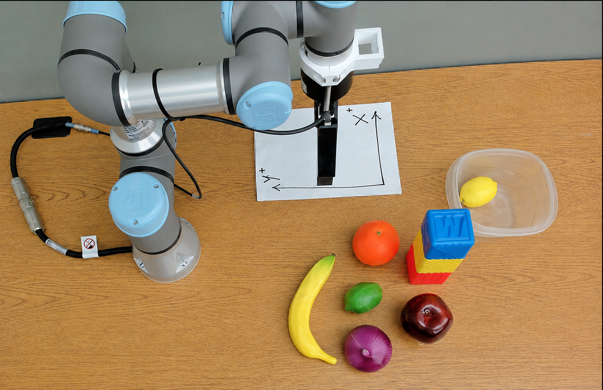
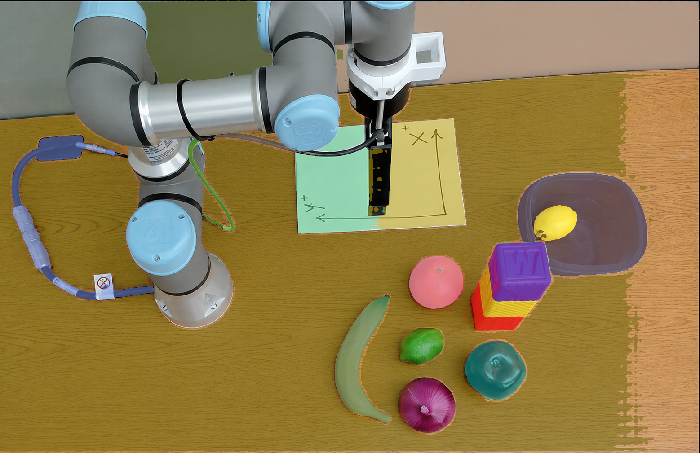
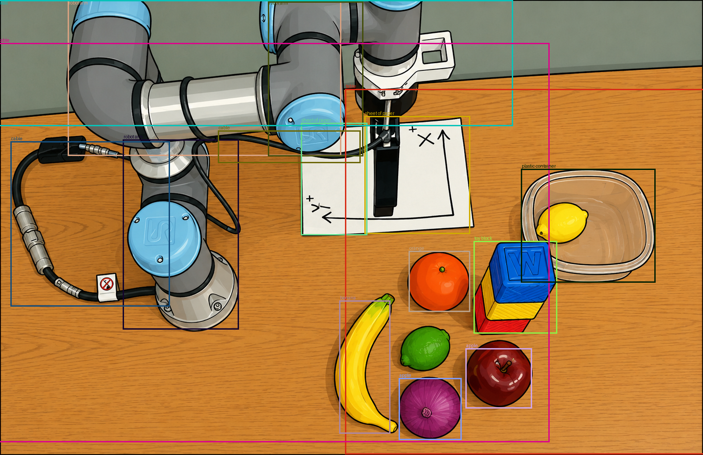
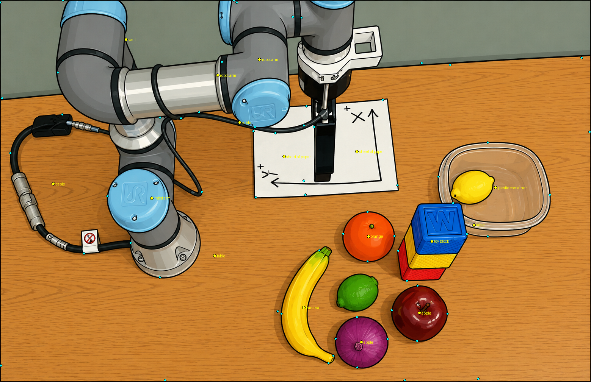
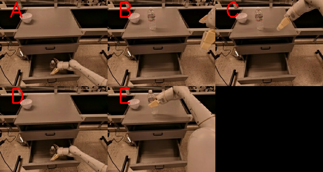
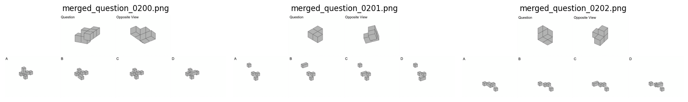
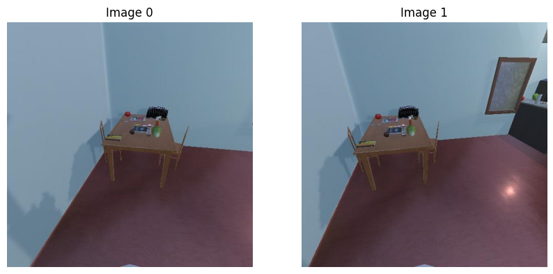
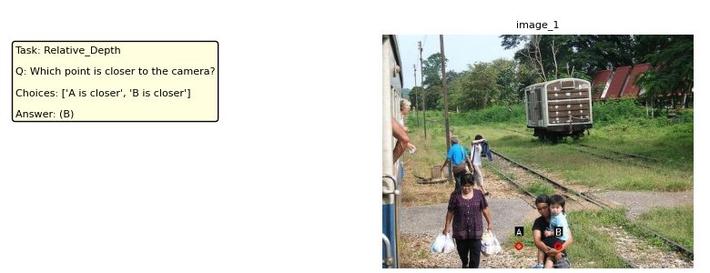
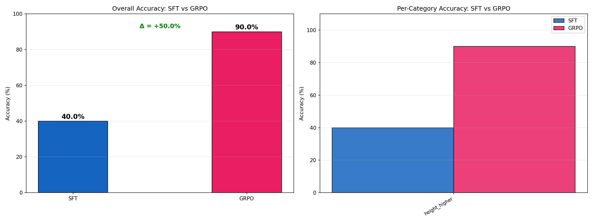

# Multimodal Datasets for Generative Reasoning

[](https://arxiv.org/abs/2610.19108)
[](LICENSE)

This repository provides a **minimal, data-centric reference** for building, extending, and analyzing datasets for generative reasoning in multimodal large language models (MLLMs).

## Survey

This repo accompanies our survey **[Towards a Data-Centric Understanding of Spatial Reasoning in Multimodal Large Language Models](https://arxiv.org/abs/2610.19108)** (Mallahnezhad, Jafaripour, Tofigh, Schoepp, Zaiane; University of Alberta and Amii). The survey reviews 28 datasets used to fine-tune MLLMs for spatial reasoning and organizes them by dataset design, dataset building, and evaluation.

The survey's paper list is in [`survey/README.md`](survey/README.md). It covers the surveyed datasets with links to paper, code, and data, a breakdown by view, modality, and annotation approach, evaluation benchmarks, and related surveys. Detailed notes on each part of the survey are in [`survey/`](survey/).

## Purpose

The goal is not to introduce a new benchmark, but to **operationalize common dataset construction patterns** observed across recent literature—including synthetic generation, automatic annotation, curation, and evaluation—especially for spatial and visual reasoning tasks.

## What's Inside

A minimal, data-centric reference for building, extending, and analyzing spatial reasoning datasets, following the pipeline in Figure 2 of the survey: data sources → perception and geometry extraction → structured spatial representation → annotation → spatial VQA output. It is educational by design, emphasizing clarity and reproducibility over scale.

* **examples/from_scratch/**: build a VQA dataset from a raw image — segmentation, bounding boxes, keypoints, then Q&A generation
* **examples/extend_existing/**: notebooks that load, inspect, and visualize existing spatial/VQA benchmarks (Robo2VLM-1, SPATIAL-DISE, SAT, BLINK, VSI-Bench, 3DSRBench)
* **notebooks/**: exploratory analysis, prompt iteration, and dataset quality inspection
  * `04_coco_vqa_spatial_dataset.ipynb`: end-to-end example transforming COCO images + annotations into a spatial VQA dataset via programmatic spatial facts and LLM-assisted question–answer generation
* **prompts/**: reusable LLM prompt templates for VQA generation, spatial relations, and quality checks
* **survey/**: companion survey notes on datasets, benchmarks, tasks taxonomy, and open gaps
* **qwen25vl_3dsrbench_lora/**, **qwen25vl_3dsrbench_grpo/**: SFT + GRPO fine-tuning of Qwen2.5-VL-3B on 3DSRBench, with adapters and result plots

## Examples

### Building a VQA dataset from scratch

[`examples/from_scratch/robot_scene/`](examples/from_scratch/robot_scene/) — starting from one raw image, run open-vocabulary segmentation (OWLv2 + SAM), draw boxes, and extract keypoints, producing the annotations a VQA-generation step consumes next.

| Original | Segmented | Bounding boxes | Keypoints |
|:---:|:---:|:---:|:---:|
|  |  |  |  |

### Extending existing datasets

[`examples/extend_existing/`](examples/extend_existing/) — notebooks that load, inspect, and visualize established spatial/visual-reasoning benchmarks, as a starting point for extending them with new questions or annotations.

| Dataset | Sample |
|---|:---:|
| **[Robo2VLM-1](examples/extend_existing/1_Robo2VLM/Robo2VLM_open.ipynb)** — VQA from in-the-wild robot manipulation trajectories |  |
| **[SPATIAL-DISE](examples/extend_existing/2_SPATIAL_DISE/SPATIAL-DISE_open.ipynb)** — unified benchmark for spatial reasoning in VLMs |  |
| **[SAT](examples/extend_existing/3_SAT/SAT_open.ipynb)** — spatial aptitude training on static & dynamic scenes |  |
| **[BLINK](examples/extend_existing/BLINK/BLINK.ipynb)** — fine-grained visual perception across 14 tasks (depth, correspondence, counting, ...) |  |
| **[VSI-Bench](examples/extend_existing/VSI-Bench/VSI_Bench.ipynb)** — visual-spatial intelligence from egocentric video | *(notebook only, no exported sample image)* |
| **[3DSRBench](examples/extend_existing/4_3DSRBech/)** — 3D spatial reasoning; also used below for fine-tuning | see results ↓ |

### Fine-tuning on 3DSRBench

[`qwen25vl_3dsrbench_lora/`](qwen25vl_3dsrbench_lora/) + [`qwen25vl_3dsrbench_grpo/`](qwen25vl_3dsrbench_grpo/) — Qwen2.5-VL-3B fine-tuned in two stages (QLoRA SFT, then GRPO reinforcement learning); full method and configs in [`examples/extend_existing/4_3DSRBech/README.md`](examples/extend_existing/4_3DSRBech/README.md).

| Stage | Accuracy |
|---|---|
| Base model | 55.5% |
| After SFT | 78.0% |
| After GRPO | 90.0% |



## Scope

This repo serves as a **companion artifact** to a survey on datasets and benchmarks for multimodal reasoning. It is intentionally modular, lightweight, and model-agnostic, designed to help researchers translate survey insights into reproducible dataset pipelines.

## Intended Use

* Building datasets from scratch (synthetic or simulated)
* Curating or extending existing multimodal datasets
* Prototyping spatial or reasoning-focused VQA data

This repository is educational and illustrative by design, emphasizing clarity and reproducibility over scale.

## Citation

If you find this survey or repository useful, please cite:

```bibtex
@article{mallahnezhad2026datacentric,
  title   = {Towards a Data-Centric Understanding of Spatial Reasoning in Multimodal Large Language Models},
  author  = {Mallahnezhad, Mahdieh and Jafaripour, Masoud and Tofigh, Mohamadali and Schoepp, Sheila and Zaiane, Osmar R.},
  journal = {arXiv preprint arXiv:2610.19108},
  year    = {2026}
}
```

## Contributing

We welcome additions. If you know of a spatial reasoning post-training dataset we missed, or a broken or missing link, please open an issue or a pull request with the paper title, venue, and links (paper, code, data).

## Acknowledgements

We acknowledge the financial support of the Pan-Canadian AI Strategy, led by CIFAR, and the Alberta Machine Intelligence Institute (Amii).

## License

This repository is released under the [MIT License](LICENSE).
