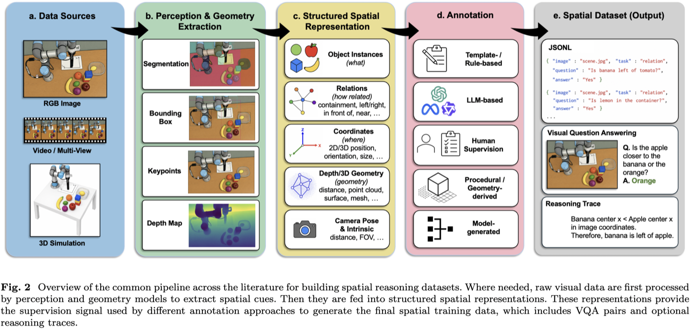

# Towards a Data-Centric Understanding of Spatial Reasoning in Multimodal Large Language Models

Mahdieh Mallahnezhad, Masoud Jafaripour, Mohamadali Tofigh, Sheila Schoepp, Osmar R. Zaiane

University of Alberta · Alberta Machine Intelligence Institute (Amii)

This page is the paper list of our survey on **datasets for post-training MLLMs/VLMs on spatial reasoning**: the surveyed datasets with links to paper, code, data, and project pages, a breakdown by view, modality, and annotation approach, evaluation benchmarks, and related surveys.

The companion code lives in the [main README](../README.md). If you find this list useful, please consider giving the repo a ⭐ and [citing our survey](../README.md#citation).

## 📰 News

- **2026-10-13**: The survey is released on [arXiv](https://arxiv.org/abs/2610.19108).

## 📑 Contents

- [Overview](#overview)
- [Spatial Reasoning Post-Training Datasets](#spatial-reasoning-post-training-datasets)
- [Evaluation Benchmarks](#evaluation-benchmarks)
- [Related Surveys](#related-surveys)
- [Companion Code](#companion-code)
- [Citation](../README.md#citation)
- [Contributing](../README.md#contributing)

## Overview

MLLMs describe scenes well but often fail at spatial questions: relative position, distance, size, and viewpoint change. We review the datasets used to fine-tune pretrained MLLMs for spatial reasoning, from supervised instruction tuning to RL with spatially grounded rewards. We organize the literature into three branches:

| Dataset design | Dataset building | Evaluation |
|---|---|---|
| Ground truth (human-supervised vs. autonomous) | Construction (ground-up, reformatting, mixing sources) | What is measured (target skill, general-capability retention) |
| Task patterns (perceptual, relational, metric, temporal, occlusion-aware, planning, perspective transformation) | Annotation (template, LLM, procedural/3D, model-generated, human) | Metrics by answer type (accuracy, tolerance, LLM-as-judge, geometric/task success, human baselines) |
| Viewpoints (single, multi) and frames of reference (ego, object, world, top-down) | Modalities and source environments | Generalization testing and open problems |

Most surveyed datasets are built with the same pipeline:

  

Detailed notes for each branch: [taxonomy](tasks_taxonomy.md) · [dataset building](datasets.md) · [evaluation](benchmarks.md) · [insights & future directions](gaps_directions.md) · [references](papers.md).

## Spatial Reasoning Post-Training Datasets

The training datasets and dataset collections from Table 1 of the survey, newest first. Benchmarks are included when a training split accompanies them.

| Dataset (Method) | Venue | Links | Scale | View | Modality | Annotation |
|---|---|---|---|---|---|---|
| **InternSpatial** Deng et al. (2026) |  | [Paper](https://arxiv.org/abs/2506.18385) · [Code](https://github.com/dengnianchen/intern-spatial) | 12M | single, multi, ego | rgb, bbox, seg, nl | llm, proc, tmpl, semi |
| **SenseNova-SI-8M (SenseNova-SI)** Cai et al. (2026) |  | [Paper](https://arxiv.org/abs/2511.13719) · [Code](https://github.com/OpenSenseNova/SenseNova-SI) · [Data](https://huggingface.co/datasets/sensenova/SenseNova-SI-8M) | 8.5M | single, multi, topdown, object, ego, world | vid, rgb, bbox, ptcl, nl | proc, other |
| **SpaceVista-1M (SpaceVista)** Sun et al. (2026) |  | [Paper](https://arxiv.org/abs/2510.09606) · [Code](https://github.com/PeiwenSun2000/SpaceVista) · [Data](https://huggingface.co/datasets/SpaceVista/SpaceVista-Full) · [Project](https://peiwensun2000.github.io/mm2km/) | 1M | multi, ego, world | vid, rgb, bbox, kpt, seg, nl | llm, proc, tmpl, semi |
| **Spatial-DISE-12K (Spatial-DISE)** Huang et al. (2026) |  | [Paper](https://arxiv.org/abs/2510.13394) · [Code](https://github.com/shinmohuang/SpatialDise) · [Data](https://huggingface.co/collections/TACPS-liv/spatial-dise) | 12.4k | single, multi, object | rgb, nl | proc, tmpl, semi |
| **SpatialLadder-26K (SpatialLadder)** Li et al. (2026) |  | [Paper](https://arxiv.org/abs/2510.08531) · [Code](https://github.com/ZJU-REAL/SpatialLadder) · [Data](https://huggingface.co/datasets/hongxingli/SpatialLadder-26k) · [Project](https://zju-real.github.io/SpatialLadder/) | 26.6k | single, multi, ego, world | vid, rgb, bbox, nl | proc, tmpl |
| **Think with 3D** Chen et al. (2026) |  | [Paper](https://arxiv.org/abs/2510.18632) · [Code](https://github.com/zhangquanchen/3DThinker) · [Data](https://huggingface.co/datasets/jankin123/3DThinker-10K) | 247kΣ | multi, ego | rgb, nl | llm |
| **3D ReasonSeg (Reasoning-based segmentation)** Ning et al. (2025) |  | [Paper](https://arxiv.org/abs/2506.23120) | 29.2k | world | seg, ptcl, nl | llm, tmpl, semi |
| **Embodied-R** Zhao et al. (2025) |  | [Paper](https://arxiv.org/abs/2504.12680) · [Code](https://github.com/EmbodiedCity/Embodied-R.code) · [Project](https://embodiedcity.github.io/Embodied-R/) | 5.4k | ego, world | vid, rgb, kpt, nl, traj | – |
| **Open Spatial Reasoning (fDPO)** Shen et al. (2025) |  | [Paper](https://arxiv.org/abs/2506.21656) | 900kΣ | single, object | rgb, seg, dmap, nl | llm, proc |
| **Open3D-VQA** Zhang et al. (2025b) |  | [Paper](https://arxiv.org/abs/2503.11094) · [Code](https://github.com/EmbodiedCity/Open3D-VQA.code) · [Data](https://huggingface.co/datasets/EmbodiedCity/Open3DVQA-v2) | 74.2kΣ | single, topdown, object, ego, world | rgb, bbox, seg, dmap, ptcl, cpose, nl | llm, proc, tmpl, semi |
| **Perception before reasoning** Chen et al. (2025b) |  | [Paper](https://arxiv.org/abs/2509.13031) · [Code](https://github.com/cythu/PeBR-R1) · [Data](https://huggingface.co/datasets/cythu/PeBR_R1_dataset) | 409kΣ | single, ego | rgb, nl | llm, tmpl, semi, full |
| **Robo2VLM-1 (Robo2VLM)** Chen et al. (2025a) |  | [Paper](https://arxiv.org/abs/2505.15517) · [Code](https://github.com/KeplerC/robo2VLM) · [Data](https://huggingface.co/datasets/keplerccc/Robo2VLM-1) · [Project](https://berkeleyautomation.github.io/robo2vlm/) | 685k | multi, ego, world | rgb, seg, nl, traj | tmpl, semi |
| **RoboSpatial** Song et al. (2025) |  | [Paper](https://arxiv.org/abs/2411.16537) · [Code](https://github.com/NVlabs/RoboSpatial) · [Project](https://chanh.ee/RoboSpatial) | 4MΣ | single, object, ego, world | rgb, bbox, dmap, ptcl, cpose, nl | llm, proc, tmpl |
| **SpaceR-151k (SpaceR)** Ouyang et al. (2025) |  | [Paper](https://arxiv.org/abs/2504.01805) · [Code](https://github.com/OuyangKun10/SpaceR) · [Data](https://huggingface.co/datasets/RUBBISHLIKE/SpaceR-151k) | 151k | single, topdown, ego | vid, rgb, bbox, ptcl, nl | proc, tmpl |
| **SPAR-7M (SPAR (From flatland to space))** Zhang et al. (2025a) |  | [Paper](https://arxiv.org/abs/2503.22976) · [Code](https://github.com/LogosIntelligenceLab/SPAR) · [Data](https://huggingface.co/datasets/jasonzhango/SPAR-7M) · [Project](https://logosintelligencelab.github.io/SPAR/) | 7M | single, multi, ego | vid, rgb, bbox, kpt | llm, proc, tmpl |
| **SpaRE** Ogezi and Shi (2025) |  | [Paper](https://arxiv.org/abs/2504.20648) | 3.8MΣ | single, object | rgb, nl | llm, proc, semi |
| **Sparkle** Tang et al. (2025) |  | [Paper](https://arxiv.org/abs/2410.16162) · [Code](https://github.com/YihongT/Sparkle) | 180kΣ | single, topdown, world | rgb, nl | proc, tmpl |
| **SpatialMosaic** Lee et al. (2025) |  | [Paper](https://arxiv.org/abs/2512.23365) · [Code](https://github.com/Kanghee-Lee/SpatialMosaic-project) · [Data](https://huggingface.co/datasets/jmkey/spatial_mosaic_vqa) · [Project](https://kanghee-lee.github.io/spatialmosaic/) | 2M | multi, ego | rgb, bbox, dmap, ptcl, cpose, nl | proc, tmpl |
| **SpatialQA† (SpatialBot)** Cai et al. (2025) |  | [Paper](https://arxiv.org/abs/2406.13642) · [Code](https://github.com/BAAI-DCAI/SpatialBot) · [Data](https://huggingface.co/datasets/RussRobin/SpatialQA) | 746k | single, object, ego | rgb, bbox, dmap, nl, traj | llm, proc, tmpl, semi |
| **SSR-COT (SSR)** Liu et al. (2025b) |  | [Paper](https://arxiv.org/abs/2505.12448) · [Code](https://github.com/yliu-cs/SSR) · [Data](https://huggingface.co/datasets/yliu-cs/SSR-CoT) · [Project](https://yliu-cs.github.io/SSR) | 1.2M | single, world | rgb, dmap, nl | llm, tmpl, other |
| **STV-205k (Video-STR)** Wang et al. (2025) |  | [Paper](https://arxiv.org/abs/2510.10976) | 205k | multi | vid, rgb, bbox, nl | proc, tmpl, full |
| **STVQA-7K (SpatialThinker)** Batra et al. (2025) |  | [Paper](https://arxiv.org/abs/2511.07403) · [Code](https://github.com/hunarbatra/SpatialThinker) · [Data](https://huggingface.co/collections/OX-PIXL/spatialthinker) · [Project](https://pixl.cs.ox.ac.uk/spatial-thinker) | 7.6k | single, ego | rgb, bbox, nl | llm, full |
| **ViGoRL** Sarch et al. (2025) |  | [Paper](https://arxiv.org/abs/2505.23678) · [Code](https://github.com/Gabesarch/grounded-rl) · [Data](https://huggingface.co/datasets/gsarch/vigorl_datasets) · [Project](https://visually-grounded-rl.github.io/) | 86.6kΣ | single, object | rgb, nl | llm, other |
| **VILASR†** Wu et al. (2025) |  | [Paper](https://arxiv.org/abs/2506.09965) · [Code](https://github.com/AntResearchNLP/ViLaSR) · [Data](https://huggingface.co/datasets/AntResearchNLP/ViLaSR-data) | 80.8kΣ | single, multi | vid, rgb, bbox, nl | llm, proc, tmpl |
| **Localize† (Learning to localize objects)** Ranasinghe et al. (2024) |  | [Paper](https://arxiv.org/abs/2404.07449) | 200k+ | single | vid, rgb, bbox, nl | llm, tmpl, semi |
| **OSD (SpatialRGPT)** Cheng et al. (2024) |  | [Paper](https://arxiv.org/abs/2406.01584) · [Code](https://github.com/AnjieCheng/SpatialRGPT) · [Data](https://huggingface.co/datasets/a8cheng/OpenSpatialDataset) · [Project](https://www.anjiecheng.me/SpatialRGPT) | 8.7M | single, ego, world | rgb, bbox, seg, dmap, nl | llm, proc, tmpl |
| **RoboPoint-1432K (RoboPoint)** Yuan et al. (2024) |  | [Paper](https://arxiv.org/abs/2406.10721) · [Code](https://github.com/wentaoyuan/RoboPoint) · [Data](https://huggingface.co/datasets/wentao-yuan/robopoint_data) · [Project](https://robo-point.github.io) | 1432k | single, ego, world | rgb, bbox, kpt, dmap, nl | proc, tmpl |
| **SpatialVLM** Chen et al. (2024) |  | [Paper](https://arxiv.org/abs/2401.12168) · [Project](https://spatial-vlm.github.io/) | 2B | single, ego, world | rgb, bbox, seg, dmap, ptcl, nl | proc, tmpl |

<b>Legend</b>

- **Scale:** rounded QA/example counts. B/M/k = billions/millions/thousands; `+` = lower bound; `Σ` = survey-computed sum across records or stage collections. `†` = a dataset family reported under one name (Localize: Localize-Instruct-200K, Localize-ActivityNet; VILASR: ColdStart-33k, RRS-8k, RL-40k; SpatialQA: SpatialQA, SpatialQA-E).
- **View:** viewpoint `single`/`multi` + frame of reference `object`/`ego`/`world`; `topdown` = flat 2D map representation.
- **Modality:** `vid` video, `rgb`, `bbox` bounding box, `kpt` keypoint, `seg` segmentation, `dmap` depth map, `ptcl` point cloud, `cpose` camera pose, `nl` natural language, `traj` trajectory.
- **Annotation:** `llm` LLM-based, `proc` procedural / 3D reconstruction, `tmpl` template / rule-based, `other` auxiliary vision models or the model's own outputs, `semi` partial human involvement, `full` full human involvement.
- **Links:** only official or author-maintained resources are listed; a missing link means none was found at the time of writing.

<b>Browse by annotation approach</b>

- **Template / rule-based** (`tmpl`, 21): 3D ReasonSeg, InternSpatial, Localize, Open3D-VQA, OSD, Perception before reasoning, Robo2VLM-1, RoboPoint-1432K, RoboSpatial, SpaceR-151k, SpaceVista-1M, SPAR-7M, Sparkle, Spatial-DISE-12K, SpatialLadder-26K, SpatialMosaic, SpatialQA, SpatialVLM, SSR-COT, STV-205k, VILASR
- **LLM-based** (`llm`, 17): 3D ReasonSeg, InternSpatial, Localize, Open Spatial Reasoning, Open3D-VQA, OSD, Perception before reasoning, RoboSpatial, SpaceVista-1M, SPAR-7M, SpaRE, SpatialQA, SSR-COT, STVQA-7K, Think with 3D, ViGoRL, VILASR
- **Procedural / 3D reconstruction** (`proc`, 19): InternSpatial, Open Spatial Reasoning, Open3D-VQA, OSD, RoboPoint-1432K, RoboSpatial, SenseNova-SI-8M, SpaceR-151k, SpaceVista-1M, SPAR-7M, SpaRE, Sparkle, Spatial-DISE-12K, SpatialLadder-26K, SpatialMosaic, SpatialQA, SpatialVLM, STV-205k, VILASR
- **Auxiliary-model or self-generated** (`other`, 3): SenseNova-SI-8M, SSR-COT, ViGoRL
- **Partial human involvement** (`semi`, 10): 3D ReasonSeg, InternSpatial, Localize, Open3D-VQA, Perception before reasoning, Robo2VLM-1, SpaceVista-1M, SpaRE, Spatial-DISE-12K, SpatialQA
- **Full human involvement** (`full`, 3): Perception before reasoning, STV-205k, STVQA-7K

<b>Browse by modality beyond RGB + text</b>

- **Video** (`vid`, 9): Embodied-R, Localize, SenseNova-SI-8M, SpaceR-151k, SpaceVista-1M, SPAR-7M, SpatialLadder-26K, STV-205k, VILASR
- **Depth maps** (`dmap`, 9): Open Spatial Reasoning, Open3D-VQA, OSD, RoboPoint-1432K, RoboSpatial, SpatialMosaic, SpatialQA, SpatialVLM, SSR-COT
- **Point clouds** (`ptcl`, 7): 3D ReasonSeg, Open3D-VQA, RoboSpatial, SenseNova-SI-8M, SpaceR-151k, SpatialMosaic, SpatialVLM
- **Camera pose** (`cpose`, 3): Open3D-VQA, RoboSpatial, SpatialMosaic
- **Keypoints** (`kpt`, 4): Embodied-R, RoboPoint-1432K, SpaceVista-1M, SPAR-7M
- **Trajectories** (`traj`, 3): Embodied-R, Robo2VLM-1, SpatialQA

<b>Browse by viewpoint and frame of reference</b>

- **Multi-view** (`multi`, 11): InternSpatial, Robo2VLM-1, SenseNova-SI-8M, SpaceVista-1M, SPAR-7M, Spatial-DISE-12K, SpatialLadder-26K, SpatialMosaic, STV-205k, Think with 3D, VILASR
- **Top-down map** (`topdown`, 4): Open3D-VQA, SenseNova-SI-8M, SpaceR-151k, Sparkle
- **Object-centric frame** (`object`, 8): Open Spatial Reasoning, Open3D-VQA, RoboSpatial, SenseNova-SI-8M, SpaRE, Spatial-DISE-12K, SpatialQA, ViGoRL
- **Egocentric frame** (`ego`, 18): Embodied-R, InternSpatial, Open3D-VQA, OSD, Perception before reasoning, Robo2VLM-1, RoboPoint-1432K, RoboSpatial, SenseNova-SI-8M, SpaceR-151k, SpaceVista-1M, SPAR-7M, SpatialLadder-26K, SpatialMosaic, SpatialQA, SpatialVLM, STVQA-7K, Think with 3D
- **World-centric frame** (`world`, 13): 3D ReasonSeg, Embodied-R, Open3D-VQA, OSD, Robo2VLM-1, RoboPoint-1432K, RoboSpatial, SenseNova-SI-8M, SpaceVista-1M, Sparkle, SpatialLadder-26K, SpatialVLM, SSR-COT

## Evaluation Benchmarks

### Benchmarks released with surveyed datasets

| Benchmark | Released with | Links |
|---|---|---|
| SpatialRGPT-Bench | SpatialRGPT (Cheng et al. 2024) | [Data](https://huggingface.co/datasets/a8cheng/SpatialRGPT-Bench) |
| SpatialBench | SpatialBot (Cai et al. 2025) | [Data](https://huggingface.co/datasets/RussRobin/SpatialBench) |
| Where2Place | RoboPoint (Yuan et al. 2024) | [Data](https://huggingface.co/datasets/wentao-yuan/where2place) |
| RoboSpatial-Home | RoboSpatial (Song et al. 2025) | [Data](https://huggingface.co/datasets/chanhee-luke/RoboSpatial-Home) · [Eval code](https://github.com/chanhee-luke/RoboSpatial-Eval) |
| SPAR-Bench | SPAR-7M (Zhang et al. 2025a) | [Data](https://huggingface.co/datasets/jasonzhango/SPAR-Bench) |
| SSRBench | SSR (Liu et al. 2025b) | [Data](https://huggingface.co/datasets/yliu-cs/SSRBench) |
| ViLaSR-eval | VILASR (Wu et al. 2025) | [Data](https://huggingface.co/datasets/AntResearchNLP/ViLaSR-eval) |
| SPBench | SpatialLadder (Li et al. 2026) | [Data](https://huggingface.co/datasets/hongxingli/SPBench) |
| SpaceVista-Bench | SpaceVista (Sun et al. 2026) | [Data](https://huggingface.co/datasets/SpaceVista/SpaceVista-Bench) |

### Out-of-domain spatial benchmarks

| Benchmark | Notes | Links |
|---|---|---|
| VSI-Bench | Visual-spatial intelligence from egocentric video; used to compare SpatialLadder training orders | [Data](https://huggingface.co/datasets/nyu-visionx/VSI-Bench) · [Example](../examples/extend_existing/VSI-Bench/) |
| CV-Bench | Out-of-domain spatial benchmark used by SpatialLadder | [Data](https://huggingface.co/datasets/nyu-visionx/CV-Bench) |
| ViewSpatial-Bench | Out-of-domain viewpoint benchmark used by SpatialLadder | [Data](https://huggingface.co/datasets/lidingm/ViewSpatial-Bench) |
| SIBench | Suite consolidating ~20 open-source spatial datasets (Yu et al. 2025) | [Paper](https://arxiv.org/abs/2509.18905) |
| BLINK | Fine-grained visual perception across 14 tasks | [Data](https://huggingface.co/datasets/BLINK-Benchmark/BLINK) · [Example](../examples/extend_existing/BLINK/) |
| SAT | Spatial aptitude on static and dynamic scenes | [Data](https://huggingface.co/datasets/array/SAT) · [Example](../examples/extend_existing/3_SAT/) |
| 3DSRBench | 3D spatial reasoning | [Data](https://huggingface.co/datasets/ccvl/3DSRBench) · [Example](../examples/extend_existing/4_3DSRBech/) |

General vision–language benchmarks used for retention checks in the surveyed works include MME, MMMU, MMBench, HallusionBench, and POPE. The evaluation practices of each work (scoring, retention, independence, robustness, human baselines) are compared in [`survey/benchmarks.md`](benchmarks.md).

## Related Surveys

| Survey | Focus | Venue |
|---|---|---|
| [A Survey of Multimodal Large Language Model from a Data-Centric Perspective](https://arxiv.org/abs/2405.16640) | Data-centric MLLM datasets and benchmarks (not spatial-specific) | arXiv 2024 |
| [When LLMs Step into the 3D World: A Survey and Meta-Analysis of 3D Tasks via Multi-modal Large Language Models](https://arxiv.org/abs/2405.10255) | 3D-LLMs, with meta-analysis | arXiv 2024 |
| [A Survey of Large Language Model-Powered Spatial Intelligence Across Scales](https://arxiv.org/abs/2504.09848) | Embodied, urban, and earth scales | arXiv 2025 |
| [How to Enable LLM with 3D Capacity? A Survey of Spatial Reasoning in LLM](https://arxiv.org/abs/2504.05786) | Image-, point-cloud-, and hybrid 3D methods | IJCAI 2025 |
| [How Far are VLMs from Visual Spatial Intelligence? A Benchmark-Driven Perspective](https://arxiv.org/abs/2509.18905) | Benchmark-driven review; introduces SIBench | arXiv 2025 |
| [Multimodal Spatial Reasoning in the Large Model Era: A Survey and Benchmarks](https://arxiv.org/abs/2510.25760) | Architectures and post-training, 2D to 3D and embodied | arXiv 2025 |
| [Spatial Reasoning in Multimodal Large Language Models: A Survey of Tasks, Benchmarks and Methods](https://arxiv.org/abs/2511.15722) | Cognitive-complexity taxonomy of tasks and benchmarks | arXiv 2025 |
| Spatial Intelligence in Vision-Language Models: A Comprehensive Survey (Liu et al.) | Intervention-based taxonomy with empirical study | Artificial Intelligence Review 2026 |
